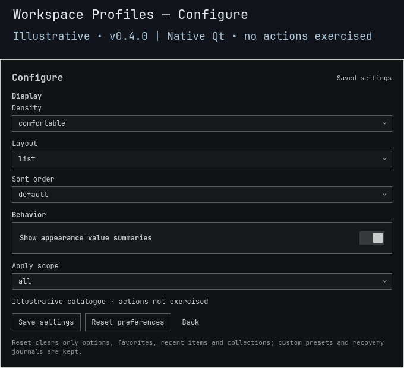

# Workspace Profiles

**Change spacing or decoration—not where your apps belong.**

Choose a dense coding layout, quieter writing surface or low-effects appearance. These are **compositor-wide values**, not per-workspace rules. Profiles never launch/move apps, assign workspaces, change tiling layouts, manage sessions, alter monitors or rewrite startup configuration.

> **v0.4.0 source candidate.** No installation or live Apply/Restore qualification is implied. The separate full-shell upgrade/rollback gate remains blocked. [Validation history](docs/VALIDATION.md).


*Illustrative **0.4.0** native Qt component render with fictional/original example data. No installed library, desktop action or full-shell behavior is demonstrated. [Preview provenance](docs/PREVIEW.md).*

<details>
<summary>Preview native saved settings</summary>



*Illustrative Configure view; fields may scroll. The capture does not exercise Save or Reset.*

</details>

## Profiles at a glance

Bundled gaps apply equally to all four sides; custom captures retain asymmetric gaps.

| Profile | Inner / outer gap | Border / rounding | Blur / shadow |
|:---|:---:|:---:|:---:|
| Compact coding | 3 / 5 | 1 / 0 | Off / off |
| Focused writing | 8 / 20 | 1 / 6 | Off / off |
| Spacious | 10 / 18 | 2 / 12 | On / on |
| Presentation | 0 / 0 | 5 / 0 | Off / off |
| Low effects | 0 / 0 | 0 / 0 | Off / off |
| Efficiency · compatibility | 0 / 0 | 1 / 0 | Off / off |
| Compact · compatibility | 3 / 5 | 1 / 0 | Off / off |
| Comfortable · compatibility | 6 / 12 | 2 / 8 | Off / off |

Eight retained names do not mean eight distinct value sets. Every built-in and imported profile contains exactly six typed, allowlisted settings.

## Apply only what you intend

In **Configure → Apply scope**, choose a scope and save. Saving changes no compositor values. **Compare and Apply use the same saved subset:**

| `applyScope` | Admitted settings |
|:---|:---|
| `all` · default | All six settings below |
| `spacing-only` | `general.gaps_in`, `general.gaps_out`, `general.border_size` |
| `effects-only` | `decoration.rounding`, `decoration.blur.enabled`, `decoration.shadow.enabled` |

Switching scope does **not** replace the first baseline, narrow external-edit checks or restrict Restore. Restore recovers the full original receipt, regardless of today's scope. Capture/export always retain all six values; a spacing-only import is still invalid.

## Controls and personal profiles

Search, then select with arrows or a row click. Selecting never applies. Open **More** for secondary actions and data fields.

| Control | Result |
|:---|:---|
| Compare | Show actual before → after differences for the saved scope; no setters or journal writes. |
| Enter / Apply | Apply the scoped appearance values for this session. |
| Restore | Return the first actual baseline, including when search has no results. |
| Capture | Name and save the current complete six-setting appearance, without applying it. |
| Export preset | Show strict versioned JSON in the result area, never write a caller-chosen file. |
| Import | Paste complete typed JSON to add a local profile; Apply remains separate. |
| Escape / outside click | Dismiss, not Undo. Escape first leaves Configure. |

**There is no timed Preview or Keep.** Applied values remain until another explicit action or an external tool changes them.

Keep up to **32** named custom profiles; duplicates are refused, never overwritten. Imports are inert data, not commands, Lua, app launches or paths. [Import format and CLI](BACKEND.md#named-captures-strict-importexport).

Other saved settings: **Density** (`comfortable` / `compact`), **Layout** (`list` / `grid`), **Sort order** (`default` / `name` / `favorites-first`), and **Show appearance value summaries** (default on). First choices are defaults. Favorites, recents and collections organize the catalogue locally. Reset clears preferences/organization but keeps custom profiles and recovery; it does not restore compositor values.

Preferences and `custom-presets.json` live under `${XDG_CONFIG_HOME:-$HOME/.config}/omarchy/lego/workspace-profiles/`; recovery under `${XDG_STATE_HOME:-$HOME/.local/state}/omarchy-workspace-profiles/`. Updates do not replace this data.

## Open and recover

Requires Omarchy Quattro, compatible Quickshell/Qt (`qs.Ui`, `qs.Commons`), Python 3 and **Hyprland Lua 0.56.2**. Other provider versions fail closed. No sibling plugin is needed. Plugins run unsandboxed inside the shell.

```sh
omarchy plugin add https://github.com/Battlelamb/omarchy-workspace-profiles --enable
omarchy-shell shell summon leviathan.workspace-profiles
# Restore in the panel BEFORE disabling or removing:
omarchy plugin disable leviathan.workspace-profiles
omarchy plugin remove leviathan.workspace-profiles
```

Install neither applies a profile nor adds shortcuts. Existing Super+Space → Appearance entries remain independent of plugin installation.

Pending intent is durable before setters; partial failures attempt compensation to the immediately previous values. Full-baseline Restore refuses divergent external edits—even outside the selected scope—and retains its journal. Config reloads and other appearance tools may therefore cause deliberate conflicts. This is not a global compositor lock: same-value **ABA edits remain undetectable**. Preserve the receipt, resolve the external conflict deliberately, and retry; Reset or uninstall is not recovery.

## Offline checks

Use a reviewed checkout and an existing private scratch directory:

```sh
TMPDIR="${TMPDIR:?Set an existing private scratch directory}" env -u PYTHONPATH PATH=/usr/bin /usr/bin/python3 scripts/run-tests.py --backend-only
bash test.sh
```

Fake-HOME/IPC checks exercise scoped setters, exact restoration, partial failure, strict imports and external-edit refusal. They are not live action qualification, hosted CI or a full-shell upgrade pass. [Preview provenance](docs/PREVIEW.md) records the current illustrative v0.4.0 Browse/Configure captures separately from historical images. No profile application is exercised by these screenshots.

[Backend contract](BACKEND.md) · [Contributing](CONTRIBUTING.md) · [Security](SECURITY.md)

**GPL-3.0-only.** Independent community plugin, not an official Omarchy or HyDE release. Efficiency retains its documented HyDE lineage; [source notices](NOTICE.md), [backend notices](NOTICE.backend.md) and the [full license](LICENSE) retain existing credits.
