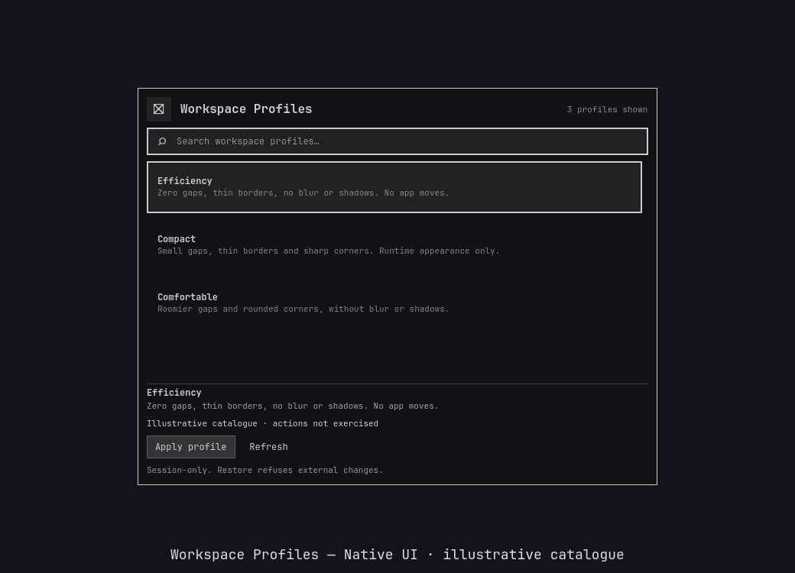

# Workspace Profiles

**Change the atmosphere, not where your apps belong.**

[](https://github.com/Battlelamb/omarchy-workspace-profiles/actions/workflows/ci.yml)

[Profiles](#find-your-working-space) · [Controls](#compare-then-apply) · [Install](#install-and-open) · [Settings](#save-your-own-profile) · [Recovery](#a-baseline-not-a-guess)

Go from dense editor spacing to a quieter writing surface with one explicit Apply. A native Omarchy panel brings gaps, borders, rounding, blur and shadows together, with a readable diff and a recorded way back. No startup configuration is rewritten.

> [!NOTE]
> **Development source snapshot · 0.3.0**, not a stable release or tagged build. Live testing verified the new runtime loaded and the populated panel opened, was captured and closed. Live Apply/Restore actions are not qualified; the separate full nested upgrade/rollback gate remains blocked.

**Appearance only.** These are compositor-wide appearance values, not per-workspace rules. Profiles do not launch or move apps, change tiling layouts, assign workspaces, restore sessions, or alter monitors or animations.



*Historical 0.2.1 native Qt/Quickshell capture from an isolated headless compositor, using an illustrative catalogue. Actions were not exercised. It shows the earlier three-entry UI, not the expanded 0.3.0 catalogue or controls. [Preview provenance](docs/PREVIEW.md).*

## Find your working space

Eight named entries are available, including the three retained compatibility entries. Gap values below apply equally to all four sides; custom captures preserve asymmetric gaps.

| Profile | Inner / outer gap | Border / rounding | Blur / shadow | Intended feel |
|:---|:---:|:---:|:---:|:---|
| **Compact coding** | 3 / 5 | 1 / 0 | Off / off | Dense, crisp editor space |
| **Focused writing** | 8 / 20 | 1 / 6 | Off / off | Quiet surface with generous margins |
| **Spacious** | 10 / 18 | 2 / 12 | On / on | Roomier spacing and rounded corners |
| **Presentation** | 0 / 0 | 5 / 0 | Off / off | Prominent borders, no gaps |
| **Low effects** | 0 / 0 | 0 / 0 | Off / off | Minimal decoration |
| **Efficiency** · compatibility | 0 / 0 | 1 / 0 | Off / off | Earlier zero-gap, thin-border profile |
| **Compact** · compatibility | 3 / 5 | 1 / 0 | Off / off | Same values as Compact coding |
| **Comfortable** · compatibility | 6 / 12 | 2 / 8 | Off / off | Earlier moderate-spacing profile |

Compatibility names and IDs remain usable; eight entries do not mean eight distinct value sets. Every profile contains exactly the same six allowlisted settings, with no hidden app/session actions.

## Compare, then apply

Type to search; use the arrow keys to select. A tile click selects only. Open **More** for comparison, capture/import fields, favorites and collections.

| Control | What happens |
|:---|:---|
| **More → Compare** | Read current values and show each before → after difference. No setters or recovery journal are written. |
| **Enter / Apply** | Apply the selected appearance values for this compositor session. |
| **Restore** | Return the first recorded baseline, not the selected profile's defaults. It remains available when search has no results. |
| **More → Capture** | Enter a name and save your current six settings, including four-sided gaps, without applying anything. |
| **More → Export preset** | Display versioned JSON in the selectable result area; no caller-chosen output file is written. |
| **More → Import** | Paste that JSON into the action-data field and add a named local profile. Apply remains a separate explicit action. |
| **Escape / click outside** | Dismiss the panel; Escape first backs out of Configure. Applied settings remain in effect. |

**No timed Preview or Keep is provided.** Workspace Profiles supports Apply and explicit Restore. Closing the panel is not Undo.

## Install and open

Requires the **Omarchy Quattro shell**, compatible Quickshell/Qt with native `qs.Ui` and `qs.Commons`, system Python 3 and `hyprctl`. The provider adapter is restricted to **Hyprland Lua 0.56.2**; other versions fail closed. No other plugin or shared installed framework is required.

Plugins run unsandboxed inside the shell. Review source and the limits above before installing this development snapshot:

```sh
omarchy plugin add https://github.com/Battlelamb/omarchy-workspace-profiles --enable
omarchy-shell shell summon leviathan.workspace-profiles
```

Installation does not automatically apply a profile or add a shortcut.

<details>
<summary><strong>Optional: Super+Space → Appearance → Workspace Profiles</strong></summary>

Back up `~/.config/omarchy/extensions/omarchy-menu.jsonc`, then merge this entry into its existing top-level object. Preserve other entries and JSONC comments; do not replace the file. This menu entry is **not auto-installed**.

```json
{
  "appearance.workspace-profiles": {
    "label": "Workspace Profiles",
    "action": "omarchy-shell shell summon leviathan.workspace-profiles"
  }
}
```

</details>

## Save your own profile

Capture your current setup or import strict, versioned preset JSON. Keep up to **32 named custom profiles**; duplicate names are refused rather than overwritten. Imports accept the plugin identity, name and six typed appearance settings, never commands, app launches, Lua or arbitrary file paths.

| Preference | Where to find it | Scope |
|:---|:---|:---|
| **Show appearance value summaries** | Configure → Save settings | Catalogue summaries only; does not apply a profile |
| **Favorites and collections** | More | Local organization of built-in and custom profiles |
| **Recent selections** | Catalogue view selector | Local history of confirmed selections |
| **Reset preferences** | Configure | Clears options, favorites, recents and collections; keeps custom profiles and recovery journals |

| Stored data | Location |
|:---|:---|
| Preferences | `${XDG_CONFIG_HOME:-$HOME/.config}/omarchy/lego/workspace-profiles/preferences.json` |
| Named profiles | `custom-presets.json` beside preferences |
| Per-session recovery | `${XDG_STATE_HOME:-$HOME/.local/state}/omarchy-workspace-profiles/` |

Data is stored outside the installed source so updates do not replace it. Reset preferences does not restore compositor values. [Exact import format and limits →](BACKEND.md#named-captures-strict-importexport)

## A baseline, not a guess

The backend records actual values before setters, retains the first session baseline across subsequent applications, and checks current values again inside compositor Lua. Partial failures attempt compensation to the immediately previous values. **Restore refuses divergent external edits** and preserves the journal rather than erasing another tool's work.

Config reloads and other appearance tools can cause a deliberate conflict. This is not a global compositor lock: same-value edits that change away and back (ABA) cannot be distinguished. Resolve a conflict deliberately and retry Restore; do not delete the journal to conceal it.

**Restore before disabling or removing:**

```sh
omarchy plugin disable leviathan.workspace-profiles
# Only if you also want to uninstall:
omarchy plugin remove leviathan.workspace-profiles
```

Remove the optional menu entry separately. Disabling or uninstalling is not a replacement for Restore.

<details>
<summary><strong>Checks, qualification limits and troubleshooting</strong></summary>

- Frozen 0.3.0 offline logic, transport and native component checks passed, including real Lua execution against fake IPC, killed-caller recovery and lost-acknowledgement controls.
- Owner-authorized live testing verified new runtime loading and populated-panel open/capture/close, not Apply/Restore integration. The separate full nested old/new/rollback gate remains blocked.
- The **Component checks** badge links to this repository's actual `ci.yml` status, not desktop-action or full-shell qualification. The [workflow](.github/workflows/ci.yml) defines its narrower hosted scope.

From a reviewed checkout, with an existing private scratch directory in `TMPDIR`:

```sh
TMPDIR="${TMPDIR:?Set an existing private scratch directory}" env -u PYTHONPATH PATH=/usr/bin /usr/bin/python3 scripts/run-tests.py --backend-only
# Full local component/native suite, using the same private TMPDIR:
bash test.sh
```

If the panel cannot open, check the shell requirements and use **Refresh** after a catalogue error. Rejected imports or duplicate names do not overwrite saved profiles. If Restore reports a conflict, preserve the receipt and inspect external edits and IPC before retrying; Reset preferences is not recovery. Do not post private desktop captures, raw logs or window titles in reports.

[Backend contract](BACKEND.md) · [Recorded validation history](docs/VALIDATION.md) · [Contributing](CONTRIBUTING.md) · [Security](SECURITY.md)

</details>

---

**GPL-3.0-only** · Independent community plugin, not an official Omarchy or HyDE release. Efficiency retains its documented HyDE lineage; other profile values and the transactional adapter are project-authored. [Source notices](NOTICE.md) · [Backend notices](NOTICE.backend.md) · [Full license](LICENSE).
